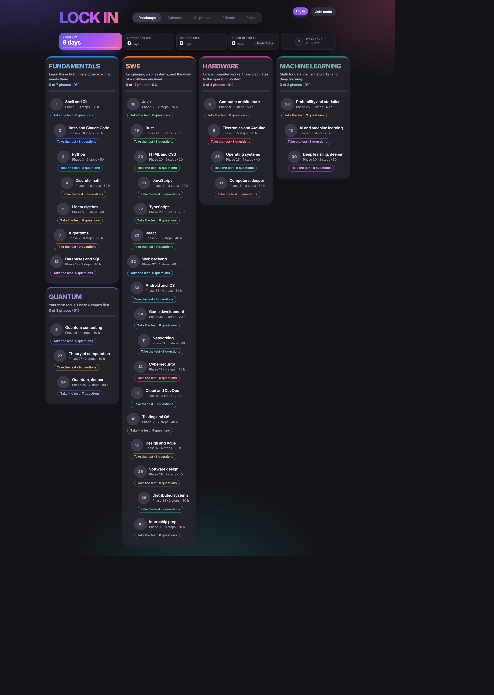
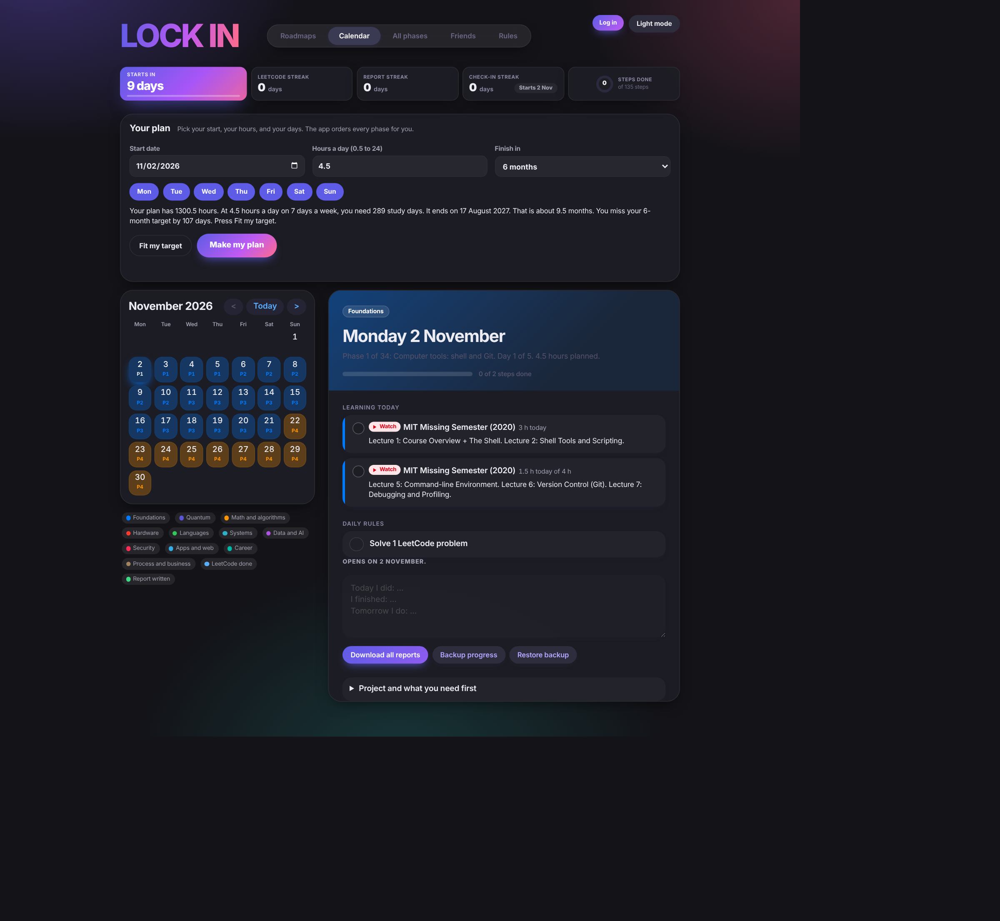
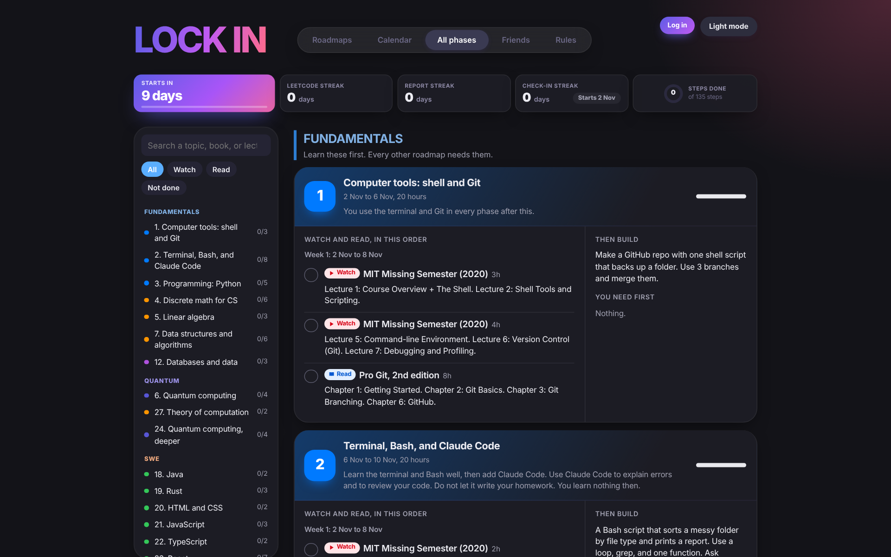
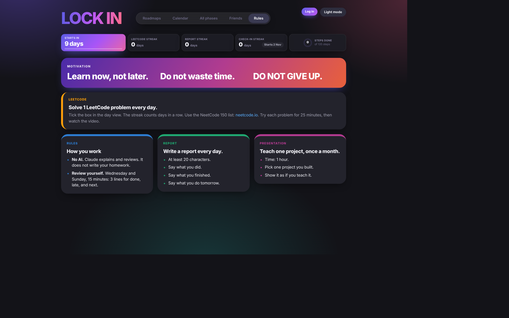
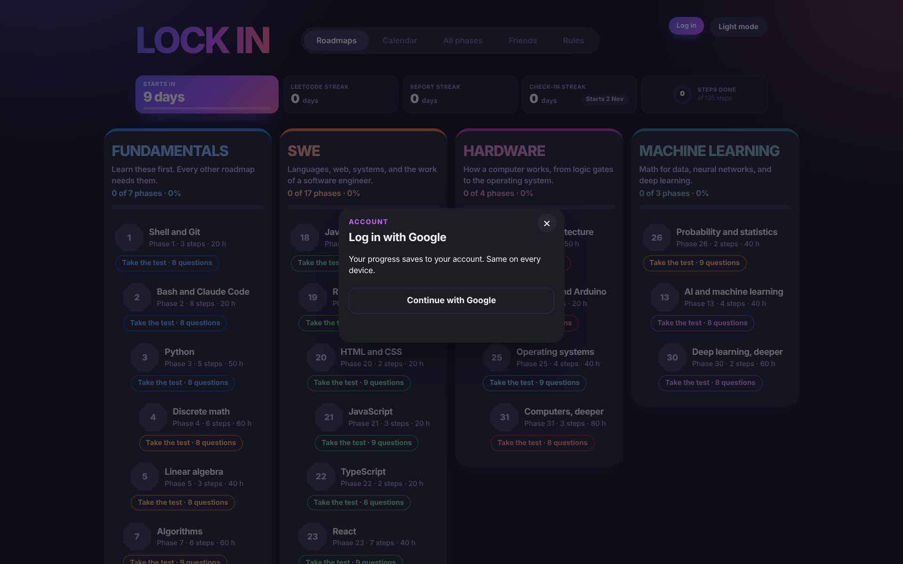
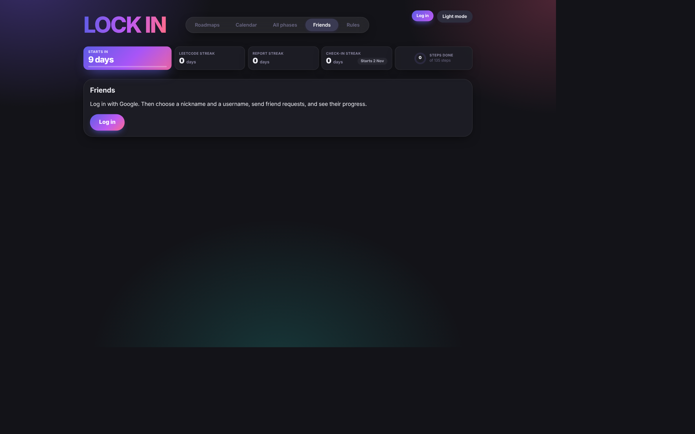
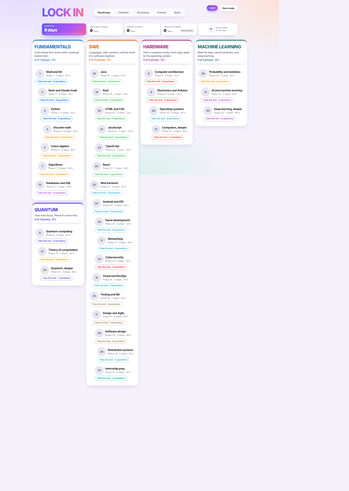
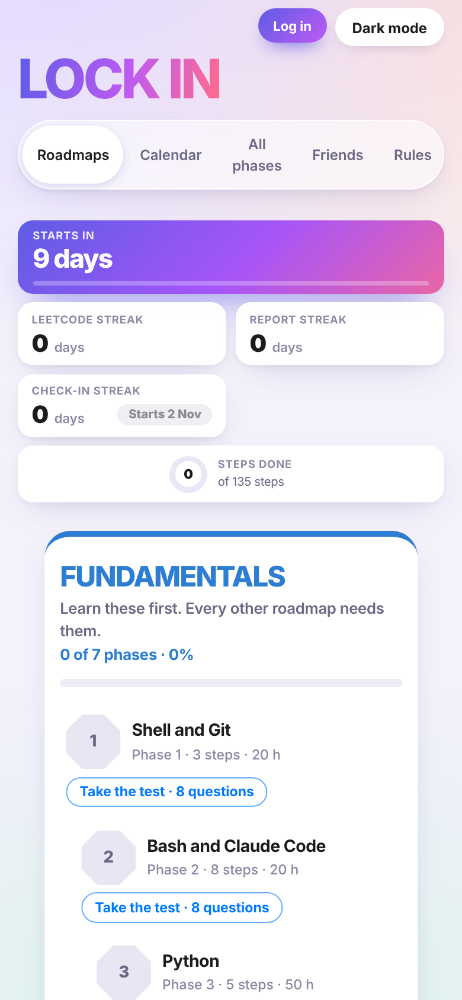

# LOCK IN

A free, from-zero IT learning planner. Pick your start date, your hours, and your study days. The app orders 34 phases for you and shows the plan on a calendar.

**Live site:** https://matsouka-maria.github.io/PLANNER/

## What it does

- **Roadmaps.** Fundamentals (with Quantum below it), SWE, Hardware, and Machine Learning. Each phase has steps, hours, and a test.
- **Calendar.** You choose the start date, hours a day (0.5 to 24), study days, and a finish target. Press Make my plan. The app orders every phase and shows the end date.
- **Streaks.** LeetCode streak, report streak, and check-in streak.
- **Check-in streak.** On each planned study day you answer one question from what you have done. A wrong answer or a missed planned day resets the streak to 0.
- **Friends.** Pick a nickname and a unique username. Send a friend request. After your friend accepts, you see their progress.
- **Settings.** Log out, change your name, or delete your account.
- **Dark and light mode.** Works on phone and desktop.

## All phases and rules

## Friends and login

Login uses Google only. You choose your name and username one time, when you create the account.

## Light mode and phone

## How it is built

- One file: `index.html`. No build step on the server.
- Hosting: GitHub Pages.
- Login and sync: Firebase Authentication (Google) and Firestore.
- Without login, progress stays in your browser (localStorage). With login, it syncs to every device.

## Set up your own copy

1. Fork this repository and turn on GitHub Pages (branch `main`, root folder).
2. Create a Firebase project. Turn on Authentication, then Google.
3. Create a Firestore database.
4. Add your GitHub Pages domain to Authentication, Settings, Authorized domains.
5. Put your web app config in `firebase-config.js`.
6. Publish Firestore rules that allow each user to write only their own documents. The rules also cover `profiles`, `names`, `friendreqs`, and `friendships`.

## Safari tips

- Do not use a private window. Login does not work there.
- To clear the cache, press Cmd+Option+E, then Cmd+R.
